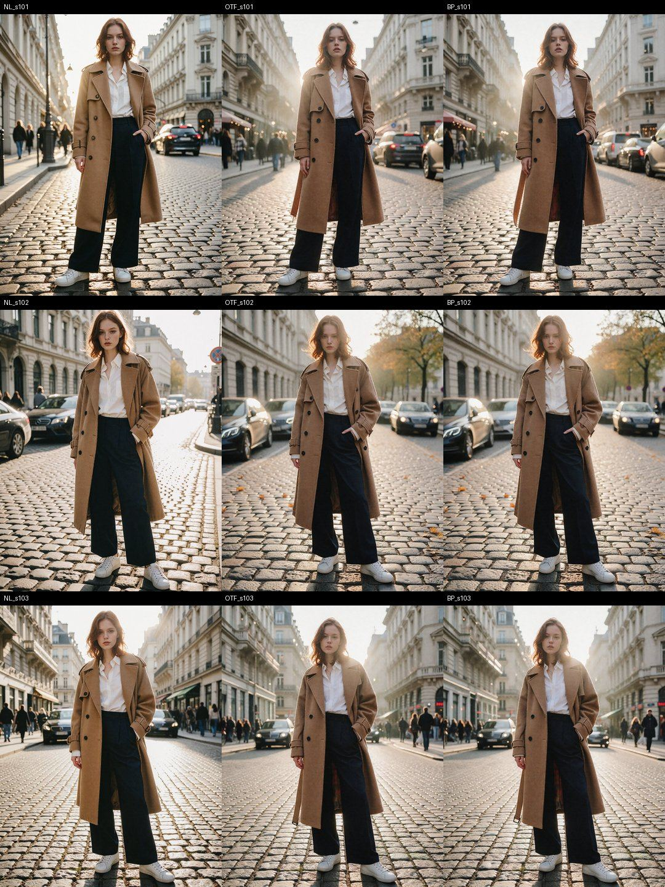
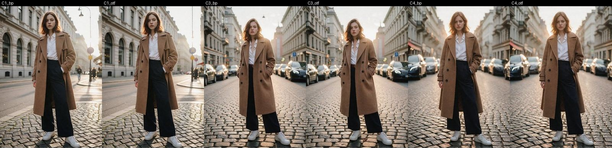
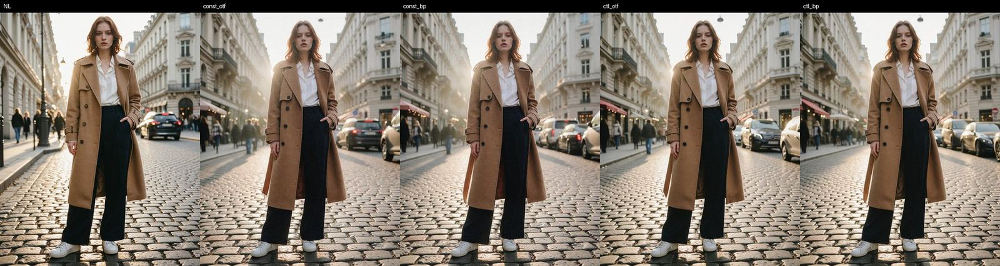
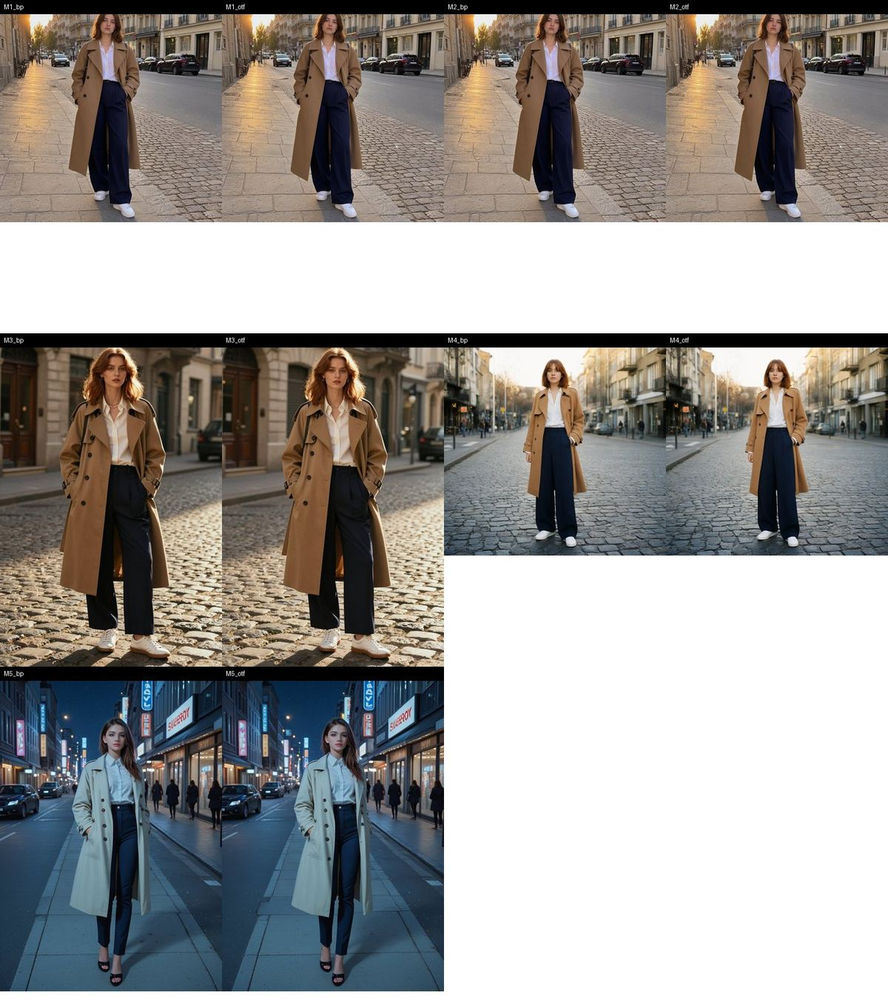
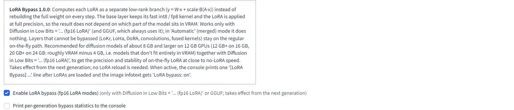
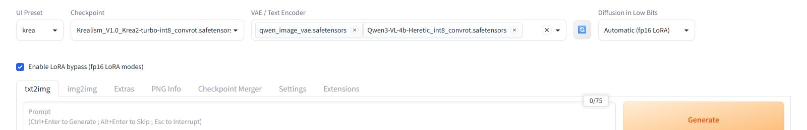

# Test report — LoRA Bypass 1.0.0

Test setup: Forge Neo 2.30, a copy of the author's working build with its extensions and settings, a separate test instance on port 7861. Windows 11, RTX 4070 12 GB (about 1.1–1.4 GB taken by the desktop), 32 GB RAM, Python 3.13, torch 2.13 + cu130. Time is measured from sending the request to receiving the image; runs 2 and 3 without changing the LoRA are counted.

Modes: **NL** — no LoRA; **MG** — Diffusion in Low Bits = Automatic (merged); **OTF** — Automatic (fp16 LoRA) with the toggle off (stock on-the-fly); **BP** — Automatic (fp16 LoRA) with the toggle on.

## Summary

| Group | Tests | Result |
|---|---|---|
| Layer-level numeric check | L1, L2, L3 | PASS |
| Krea 2 generations | G1, G2, G3, G4, G5, S1, S2 | PASS |
| Compatibility | C1–C4 | PASS |
| Other models | M1–M5 | PASS |
| UI and package | U1, U2, I1 | PASS |
| Load from other programs | P1, P2 | bypass stays active; the slowdown comes from memory paging and is fixed by `--pin-shared-memory` |

## Speed (S1, S2)

Krea 2 (Krealism int8, 12.8 GB), 1152×1536, ER SDE, Simple, 8 steps, CFG 1, seed 101.

| LoRA | NL | MG | OTF | BP | BP − NL | BP − OTF |
|---|---|---|---|---|---|---|
| PhotoReal Fixed V4, 111 MB | 23.39 s | 28.89 s | 40.14 s | **25.43 s** | +2.0 s | −14.7 s (−37%) |
| PhotoReal V6, 914 MB | — | — | 41.14 s | **26.09 s** | — | −15.1 s |
| 914 MB + 111 MB | — | — | 43.56 s | **28.40 s** | — | −15.2 s |

The S1 criterion (BP ≤ NL + 3.5 s and BP ≤ OTF − 5 s) is met. With the heavy LoRA and with two LoRAs there is no OOM, and the VRAM peak is the same as in OTF (≈ 10.3 GB for the whole card).

Other models, warm runs (average of two), time per image:

| Model | Settings | OTF | BP |
|---|---|---|---|
| MOSS-Image int8 + iPhone_V1 | 1024×1024, 24 steps, CFG 3 | 69.3 s | **47.9 s** |
| MOSS-Image int8 + iPhone_V1, Speed Boost (Fused SiTU) | same | 52.5 s | **35.9 s** |
| Z-Image Turbo int8 + Details | 1024×1536, 9 steps | 19.2 s | **12.8 s** |
| Qwen-Image 2.1 int8 + Lenovo | 1024×1024, 16 steps, CFG 2.5 | 35.9 s | **22.9 s** |
| SDXL fp16 (CyberRealistic Pony) + Night-XL | 832×1216, 24 steps | 10.7 s | 10.7 s |

There is no gain on the fp16 model: there is nothing to dequantize, and stock on-the-fly is already cheap. All of the gain is on quantized models (int8 / fp8 / GGUF).

## Stability and regression (G1, G3, G4, G5)

| ID | Check | Result |
|---|---|---|
| G1 | OTF (toggle off) with the extension vs OTF without the extension, 2 seeds | byte-identical (pixel sha256) |
| G1 | MG with the extension vs MG without it (1st and 2nd run after a restart) | byte-identical |
| G3 | BP, the same seed twice in a row | byte-identical |
| G3 | BP after a restart with `--reserve-vram 2`: 6409 MB of the model on the GPU instead of 7843 MB | byte-identical to the normal launch |
| G4 | 10 BP generations in a row, Forge process memory (torch allocated / reserved) | +13.5 MB / +32 MB over 10 generations (OTF behaves the same), no OOM |
| G5 | BP → switch off via `/sdapi/v1/options` → OTF → switch on → BP | 0 LoRA reloads; BP = BP from G2, OTF = OTF from G2 = OTF without the extension |

For comparison: in MG mode the same generation (seed 101) gave a **different image on every run** (three different hashes in a row), because the boundary between layers in VRAM and in RAM shifts by tens of megabytes between runs. This is the original problem the extension addresses. The extension's counters showed that in every Krea 2 generation all 256 layers went through bypass on every step (2048 calls for 8 steps), without a single fallback to the stock path.

## Image equivalence (G2, C, M)

PSNR between BP and OTF compared with the effect of the LoRA itself (OTF vs NL), Krea 2, LoRA 111 MB:

| Seed | PSNR(BP, OTF) | PSNR(OTF, NL) |
|---|---|---|
| 101 | 21.7 dB | 14.4 dB |
| 102 | 27.7 dB | 12.0 dB |
| 103 | 23.1 dB | 14.6 dB |

Visually it is the same frame: pose, face, clothes, background; the differences are in small background details (cars, passers-by).

## Compatibility (C1–C4)

One BP and one OTF generation per item, no errors in the log.

| ID | What | PSNR(BP, OTF) | OTF | BP |
|---|---|---|---|---|
| C1 | ADetailer (face_yolov8n) on top of a generation with LoRA | 24.4 dB | 39.2 s | 28.5 s |
| C2 | LoRA Control `[1@0,0@1]` | 20.7 dB | 40.2 s | 27.6 s |
| C3 | Batch count 2 | 25.3 dB | 50.8 s | 32.2 s |
| C4 | Two LoRAs (PhotoReal + Detail slider) | 28.2 dB | 26.5 s | 18.1 s |

In C2 the image with a strength schedule differs from constant strength 1.0 in the same way in OTF and BP: the LoRA strength is read on every step.

## Other models (M1–M5)

| ID | Model + LoRA | PSNR(BP, OTF) | Bypass |
|---|---|---|---|
| M1 | MOSS-Image int8 + iPhone_V1, Speed Boost off | 29.7 dB | 164/164 layers |
| M2 | same, Speed Boost on (Fused SiTU) | 26.6 dB | 123 layers via bypass; 41 `ffn_down` layers run through the fused `linear_input_act` kernel → stock on-the-fly |
| M3 | Z-Image Turbo int8 + Details | 20.2 dB | 180/180 |
| M4 | Qwen-Image 2.1 int8 + Lenovo | 32.6 dB | 160/160 |
| M5 | SDXL fp16 (CyberRealistic Pony) + Night-XL (LoCon) | 31.3 dB | 739/750; 11 convolution layers → stock on-the-fly |

## Layer-level numeric check (L1–L3)

The `GET /lora_bypass/selftest` endpoint runs the current model's layers on random input and compares every checked layer in BP and in OTF with a float32 reference `x·(W_deq + ΔW)ᵀ + b`. Besides the total error, it measures the error of the fast base path alone (without LoRA) and the accuracy of the LoRA term.

| ID | Model + LoRA | Bypassed | BP error (median) | OTF error | Base int8 path error without LoRA | LoRA term error: BP / OTF | Result |
|---|---|---|---|---|---|---|---|
| L1 | Krea 2 + PhotoReal 111 MB | 256/256 | 1.00% | 0.32% | 0.99% | 0.22 / 0.59 | PASS |
| L2 | Z-Image + Details | 180/180 | 0.97% | 0.21% | 0.96% | 0.84 / 2.27 | PASS |
| L2 | SDXL fp16 + Dark (UNet) | 280/280 | 0.029% | 0.029% | 0.021% | 0.03 / 0.06 | PASS |
| L2 | SDXL fp16 + Dark (text encoder) | 176/176 | 0.17% | 0.17% | 0.17% | — | PASS |
| L2 | MOSS + iPhone_V1 | 164/164 | 0.97% | 0.30% | 0.95% | 0.39 / 0.85 | PASS |
| L2 | Qwen-Image 2.1 + Lenovo | 160/160 | 0.98% | 0.33% | 0.97% | 0.20 / 0.52 | PASS |
| L3 | synthetic: LoKr, LoHa, DoRA, LoRA + bias, `diff`, 2 plain LoRAs | 2/7 | — | — | — | — | PASS: 5 layers fall back, result byte-identical to OTF |
| L3 | a real 160-byte Krea 2 LoRA file (a single `diff` on `txtfusion.projector`) | 0/1 | — | — | — | — | PASS: fallback, generation without errors |

How to read it: for int8 models the total BP error (≈1%) equals the error of Forge's fast int8 kernel itself (activation quantization; the same error is present in generations without LoRA and in merged mode). Stock on-the-fly does not have it because instead of the int8 kernel it dequantizes the weight and multiplies in bf16, which is exactly what makes it slow. The LoRA term itself is computed 2–3× more precisely by bypass than by on-the-fly, which re-rounds `W + ΔW` to bf16 and loses the low bits of a small ΔW. The original acceptance criterion ("BP error ≤ 1.5 × OTF error") was therefore refined: BP adds no error beyond the layer's own fast path, and the LoRA term is no worse than in OTF. In two unused CLIP-L layers (layer 11) of this SDXL model the output is already non-finite in the model itself; the self-test reports such layers separately, and the NaN pattern is the same in BP and OTF.

## Load from other programs (P1, P2)

Reported scenario: if you work in other programs (browser, video) without closing Forge, the next generation starts with a noticeable delay, and the time with bypass grows from ~25 s to 33–40 s.

Cause. With Krea 2 and its text encoder the Forge process holds about 33 GB of committed memory (on 32 GB RAM; the same in the working and the test build, so it is not a leak). After every generation Forge moves the diffusion model from VRAM to RAM to make room for the VAE (≈8 GB back and forth every generation, about 2 million page faults). While Forge is idle, other programs take memory, Windows pages the model weights out to compressed memory and the page file, and the next generation waits for them to come back. VRAM taken by other programs reduces the share of the model on the GPU, so more layers have to be streamed from RAM on every step.

Method: a helper process (not part of this repository) allocated and touched RAM or VRAM to imitate a browser; BP and OTF were switched with the toggle without reloading the LoRA; Krea 2 + PhotoReal 111 MB, seed 101, 1152×1536, 8 steps. P1 is a normal launch, P2 a launch with Forge's `--pin-shared-memory` flag.

| Conditions | BP | BP + pin | OTF | OTF + pin |
|---|---|---|---|---|
| Generations back to back, no load | 26.2 s | 26.6 s | 43.7 s | 41.5 s |
| Another process took RAM (free + 8 GB) for 30 s and closed | 31.8 s | **26.7 s** | 52.5 s | 46.0 s |
| Another process holds RAM (free + 2 GB) during generation | 34.5 s | 30.1 s | 43.4 s | 43.0 s |
| Another process holds 1.5 GB of VRAM during generation | 31.3 s | 29.5 s | 66.3 s | 50.2 s |

- In every scenario the extension's counters showed 256/256 layers through bypass (2048 calls per generation) with no fallbacks; BP and OTF images were byte-identical to those without load.
- `--pin-shared-memory` pins the offloaded weights (up to 14.7 GB with 32 GB RAM), so Windows cannot page them out: the "took RAM and closed" scenario no longer slows BP down.
- Regression with `--pin-shared-memory`: C4 (two LoRAs) 18.3 s (was 18.1), switching to Z-Image and back without errors, LoRA 914 MB 26.3 s and 914 + 111 MB 28.4 s (were 26.1 and 28.4). In every case the images are byte-identical to the runs without the flag.
- The flag does not pin the text encoder (Qwen3-VL, 5.4 GB): the first generation with a new prompt after memory pressure takes 3–5 s longer (in one case, after very heavy pressure, the encoder took 16 s to load instead of 1 s). This is the same with and without the flag.

## UI and package (U1, U2, I1)

- U1: Settings → LoRA Bypass shows the description, the toggle (on by default) and the statistics option; the toggle can be added to Quicksettings through the standard `quicksettings_list` and then appears in the top bar.
- U2: with BP the console prints `[LoRA Bypass] UNet: 256/256 LoRA layers bypassed` and the infotext contains `LoRA bypass: on`; in OTF and MG the field is absent; PNG Info reads the field, and regenerating from pasted parameters works without errors.
- I1 (simulated Forge folder): install, verify, reinstall of the same version, refusal over a different version, detection of a modified file, refusal while the Forge port is in use (install and rollback), rollback, repeated rollback, refusal on a foreign extension folder — 14/14 PASS; after rollback the folder is byte-identical to the original.

